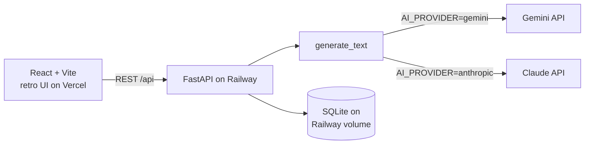

# AI Study Companion — learn AI like a Pokémon trainer

**[Live demo](https://ai-study-companion-rmfu.vercel.app)** · [API docs](https://zealous-tenderness-production-1695.up.railway.app/docs) · Frontend on Vercel, API on Railway

A gamified AI tutor for beginners learning AI and machine learning. Ask questions and get plain-language explanations, take AI-generated quizzes, earn XP, coins and badges, and challenge "Gym Leader" expert quizzes, all in a retro Pokémon FireRed style.

## The problem

Beginners start AI courses with enthusiasm and drop off within weeks. Textbook explanations assume too much, practice questions run out, and there's no sense of progress. Generic chatbots answer questions but don't track what you've learned or push you to practise.

## What it does

- **Explain:** ask anything about AI or ML and get a beginner-friendly answer.
- **Quizzes on demand:** multiple-choice quizzes generated for any topic and difficulty, so practice never runs out.
- **Gym Leader quizzes:** harder, reasoning-based questions that test real understanding instead of definitions.
- **Progress that feels like a game:** XP, coins, levels, badges, a quiz history, and a world map of topics (Intro to AI → Machine Learning → Neural Networks → Deep Learning) that unlock as you go.
- **Professor AI:** reads your stats and tells you, in character, where you're strongest and what to practise next.

## Product decisions and trade-offs

| Decision | Why | Trade-off accepted |
| --- | --- | --- |
| Game mechanics (XP, badges, unlockable topics) around the AI | Retention, not answers, is the hard problem for self-learners | More state and UI to build than a plain chatbot |
| Quizzes generated per request as strict JSON | Unlimited fresh practice on any topic without writing a question bank | Needs JSON validation and a fallback when the model returns bad output |
| One `generate_text()` helper for every AI call, provider set by an env var | Switched from Claude to Gemini by changing config, not code; easy to compare models later | Lowest-common-denominator features across providers |
| SQLite on a persistent Railway volume | Zero-cost, zero-ops database that fits a single-instance demo | Doesn't scale past one instance; Postgres is the next step |
| Split deploy: React on Vercel, FastAPI on Railway | Static frontend on a CDN; long-running Python API where it fits | CORS and two deploy pipelines to keep in sync |

## How it works



**Stack:** React 18 + Vite · FastAPI (Python) · Gemini API via `google-genai` (Claude supported as a fallback) · SQLite · Railway · Vercel

## Status and what's next

- Live: signup, login, explanations, both quiz types, scoring, badges, progress and Professor AI are all working in production.
- **Next:** real JWT authentication (the demo currently returns a placeholder token), an evaluation set to measure quiz quality across models, and moving to Postgres.

---

## Run it locally

### 1. Backend

```bash
pip install -r requirements.txt
cp .env.example .env        # then add your GEMINI_API_KEY
uvicorn backend.main:app --reload
```

The API runs at `http://127.0.0.1:8000`, with interactive docs at `/docs`.

Key environment variables (see `.env.example`):

| Variable | Purpose |
| --- | --- |
| `AI_PROVIDER` | `gemini` or `anthropic`. Defaults to `gemini` when `GEMINI_API_KEY` is set |
| `GEMINI_API_KEY`, `GEMINI_MODEL` | Gemini credentials and model (default `gemini-3.5-flash-lite`) |
| `ANTHROPIC_API_KEY`, `ANTHROPIC_MODEL` | Optional Claude fallback (default `claude-haiku-5-5`) |
| `DATABASE_PATH` | SQLite file location (`/data/study_companion.db` in production) |
| `CORS_ALLOW_ORIGINS`, `CORS_ALLOW_ORIGIN_REGEX` | Which frontends may call the API |

### 2. Frontend

```bash
cd frontend-retro
cp .env.example .env        # VITE_API_URL=http://127.0.0.1:8000/api for local dev
npm install
npm run dev
```

A simpler Streamlit prototype UI is also available: `streamlit run frontend/app.py`.

## Deploy

**Backend (Railway):** create a service from this repo (`railway.json` and `Procfile` are included). Set the variables above, and attach a volume mounted at `/data` with `DATABASE_PATH=/data/study_companion.db`. Without the volume, every redeploy wipes all users and progress.

**Frontend (Vercel):** import the repo with root directory `frontend-retro` (Vite preset) and set `VITE_API_URL=https://<your-railway-app>.up.railway.app/api`. `vercel.json` rewrites all routes to `index.html` so client-side routing survives refreshes.

## Project structure

```text
backend/          FastAPI app: routes, auth, AI service, quiz generator, gamification
database/         SQLite access layer
frontend-retro/   React + Vite retro UI (the live app)
frontend/         Streamlit prototype
prompts/          Prompt templates
```
